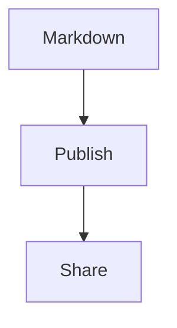

# Markdown Sharing Test

Synthetic fixture for MPIRF-R001. Safe to upload to third-party share tools.

This is **bold** and *italic* text, plus `inline code`.

> This is a blockquote used to check basic Markdown fidelity.

## Code

```js
const greeting = "Hello Markdown";
console.log(greeting);
```

## Image


## Attachment reference

See the companion file: [[sample-attachment]]  
(Also referenced as a vault-relative text asset in `assets/sample-attachment.txt`.)

## Table

| Feature | Status |
| --- | --- |
| Markdown | Supported |
| Image | To test |
| Wikilink | To test |

## Internal link

[[Another Note]]

## Callout

> [!NOTE] This is a callout test.

## Mermaid



## Task list

- [x] Create note
- [ ] Share note
- [ ] Update note

## Long-content sample

Line 01 — packing density check for scroll and typography.
Line 02 — packing density check for scroll and typography.
Line 03 — packing density check for scroll and typography.
Line 04 — packing density check for scroll and typography.
Line 05 — packing density check for scroll and typography.
Line 06 — packing density check for scroll and typography.
Line 07 — packing density check for scroll and typography.
Line 08 — packing density check for scroll and typography.
Line 09 — packing density check for scroll and typography.
Line 10 — packing density check for scroll and typography.
Line 11 — packing density check for scroll and typography.
Line 12 — packing density check for scroll and typography.
Line 13 — packing density check for scroll and typography.
Line 14 — packing density check for scroll and typography.
Line 15 — packing density check for scroll and typography.
Line 16 — packing density check for scroll and typography.
Line 17 — packing density check for scroll and typography.
Line 18 — packing density check for scroll and typography.
Line 19 — packing density check for scroll and typography.
Line 20 — packing density check for scroll and typography.

## End marker

`MPIRF_R001_BENCHMARK_END`
